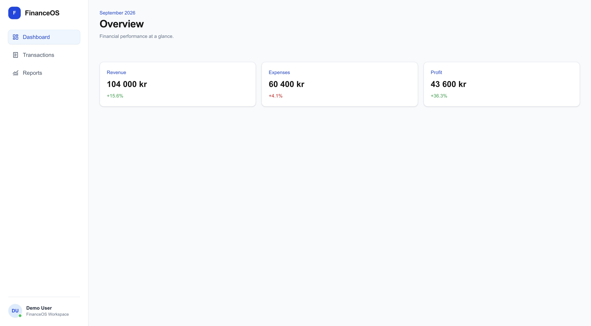
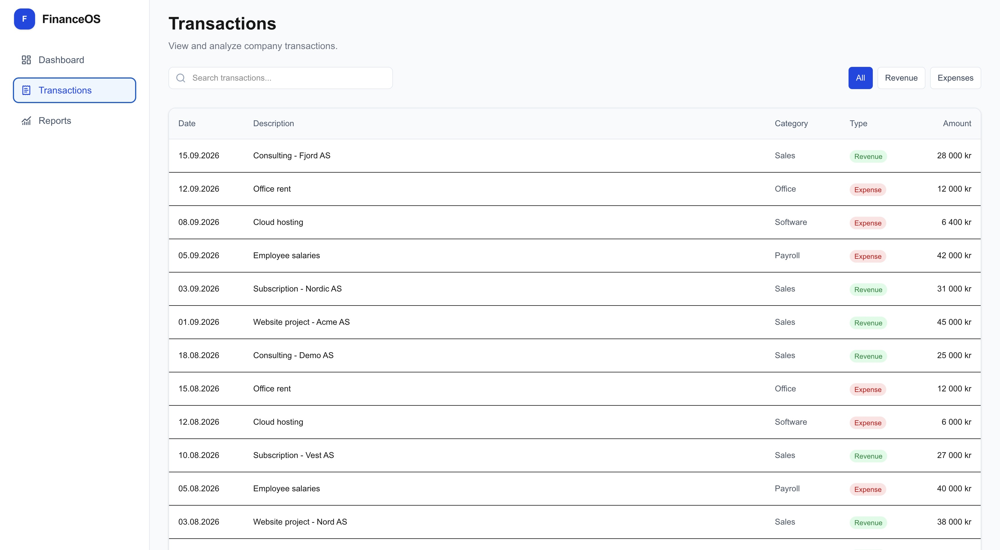
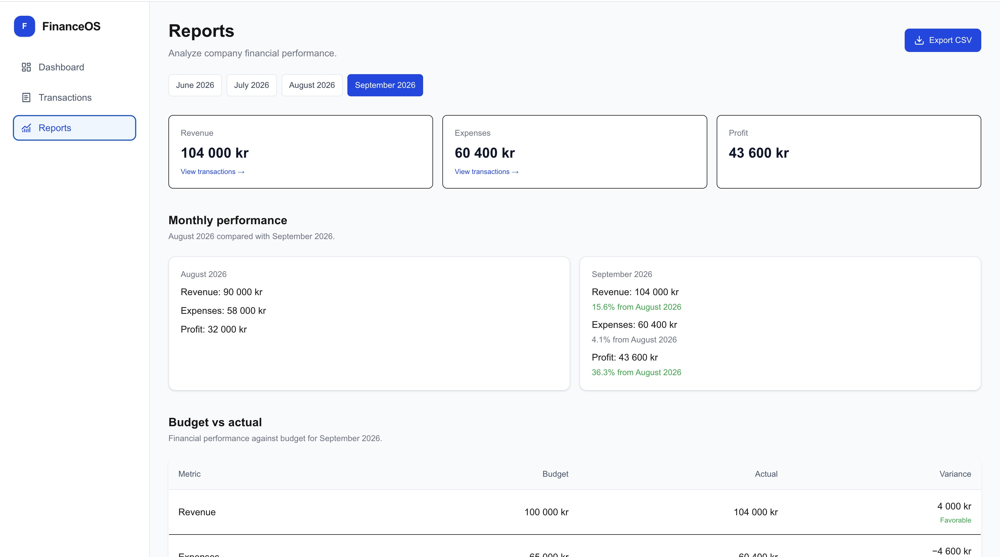

# FinanceOS

**A financial dashboard for small businesses, built with Next.js, TypeScript, and PostgreSQL.**

FinanceOS is a portfolio project exploring how financial transaction data can be transformed into useful reports, visualizations, and decision-support insights.

The application uses fictional financial data and demonstrates full-stack development, financial data analysis, and backend integration concepts.

**Live Demo:** [View FinanceOS](https://finance-os-zeta.vercel.app/)

## Screenshots

### Dashboard



### Transactions



### Reports



## Features

- **Dashboard** – Overview of revenue, expenses, and profit, including month-over-month changes.
- **Transactions** – Browse, search, and filter financial transactions by type, description, category, and date.
- **Monthly reports** – Analyze financial performance across available reporting periods.
- **Budget vs. actual** – Compare actual results with budgeted revenue, expenses, and profit.
- **Financial insights** – Generate observations based on monthly financial performance.
- **Forecasting** – Estimate the next month's revenue, expenses, and profit using a three-month moving average.
- **CSV export** – Download monthly financial reports for use in Excel, Power BI, and other analysis tools.
- **Accounting integration (demo)** – Import simulated accounting transactions with validation and duplicate prevention.
- **Responsive interface** – Navigate the application on desktop and mobile devices.

## Accounting Integration (Demo)

FinanceOS includes a simulated accounting integration demonstrating how financial transactions can be imported from an accounting system.

### Features

- Mock accounting API returning structured transaction data.
- Runtime validation of transaction fields and data types.
- PostgreSQL import using Drizzle ORM.
- Duplicate prevention using external transaction IDs and source identifiers.
- Import endpoint protected by a secret and restricted to development environments.

### How It Works

The integration uses fictional accounting transactions to simulate data received from an external system.

Incoming transactions are validated before being saved to PostgreSQL. Each imported transaction is identified by its source and external ID.

A unique database index prevents duplicate records when the same transactions are imported multiple times.

The import process has been tested to confirm that repeated imports do not create duplicate transactions.

**Important:** This is a demonstration integration using mock data, not a live connection to Tripletex or another accounting provider. The import endpoint is intentionally disabled in production.

## Tech Stack

| Technology           | Purpose                                  |
| -------------------- | ---------------------------------------- |
| Next.js (App Router) | Full-stack application framework         |
| React                | User interface                           |
| TypeScript           | Type-safe application development        |
| Tailwind CSS         | Responsive styling                       |
| PostgreSQL (Neon)    | Relational database                      |
| Drizzle ORM          | Database queries, schema, and migrations |
| Lucide React         | Interface icons                          |
| Vercel               | Deployment and hosting                   |

## How It Works

FinanceOS stores sample financial transactions and monthly budgets in PostgreSQL.

The application retrieves and aggregates this data using Drizzle ORM. Server-side calculations produce monthly financial summaries, budget comparisons, and financial insights.

Forecasts are calculated using a three-month moving average of historical financial data.

Users can export monthly financial summaries as CSV files through a Next.js API route.

The accounting integration demonstrates how external transaction data can be validated and imported into the existing database while preventing duplicates.

## Getting Started

### Prerequisites

- Node.js
- npm
- A PostgreSQL database

### Installation

Clone the repository:

```bash
git clone https://github.com/vildehf/finance-os.git
cd finance-os
```

Install dependencies:

```bash
npm install
```

Create a `.env.local` file in the project root and configure your database connection:

```env
DATABASE_URL=your_postgresql_connection_string
```

To test the accounting import locally, also configure an import secret:

```env
ACCOUNTING_IMPORT_SECRET=your_secure_random_secret
```

Start the development server:

```bash
npm run dev
```

Open [http://localhost:3000](http://localhost:3000) in your browser.

### Testing the Accounting Import

With the development server running and `ACCOUNTING_IMPORT_SECRET` configured, execute:

```bash
node --env-file=.env.local -e '
fetch("http://localhost:3000/api/accounting/import", {
  method: "POST",
  headers: {
    Authorization: `Bearer ${process.env.ACCOUNTING_IMPORT_SECRET}`,
  },
})
  .then(async (response) => {
    console.log("HTTP status:", response.status);
    console.log(await response.json());
  })
  .catch(console.error);
'
```

The first successful import adds the three example transactions. Subsequent imports skip transactions that already exist.

The import endpoint is available only in development mode.

**Note:** A PostgreSQL database with the required schema and sample data is needed to display financial information. The database connection string and import secret are not included in this repository. Database migrations must be applied before importing transactions.

## Project Status

FinanceOS is an ongoing portfolio project.

The current version demonstrates financial reporting, transaction filtering, forecasting, CSV export, and a simulated accounting integration using fictional financial data.

Potential future improvements include:

- Live integration with accounting systems such as Tripletex.
- More detailed transaction drilldowns.
- Additional export formats.
- Expanded forecasting and financial analysis.
- User authentication and company-specific settings.

## Disclaimer

FinanceOS uses fictional financial data and is not intended for production accounting or real-world financial decision-making.

## Author

Developed as a personal full-stack development and financial analytics portfolio project.
